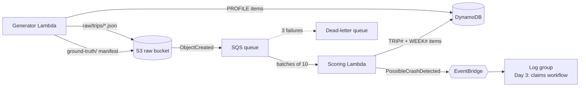
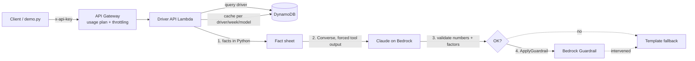
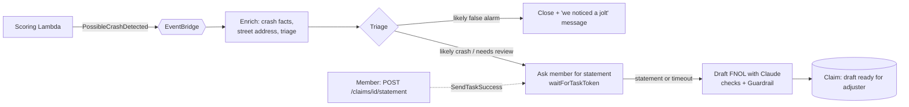

# insurance-telematics-genai

A deploy-and-destroy demo showing how an auto insurer can turn telematics data
into a differentiator with gen AI. Everything runs in your own AWS account,
is defined in **AWS CDK (Python)**, and uses **synthetic data only**.

| Day | Feature | Status |
|-----|---------|--------|
| 1 | Foundation: synthetic trip generator, rule-based scoring, weekly aggregates | ✅ done |
| 2 | Score explainer and coach (Claude on Bedrock + Guardrail) behind an API | ✅ done |
| 3 | Possible crash → triage → member statement → FNOL draft (EventBridge + Step Functions + Bedrock) | ✅ done |
| 4 | Demo UI, agent copilot, demo script | planned |

## Architecture (Day 1)



**Generator** builds drivers in six metros with hidden personas (steady,
rusher, distracted, night owl, new driver) and week-over-week trends (some
improve, some decline). Each trip looks like a phone SDK upload: GPS/speed
samples every 10 s plus on-device events (hard brake, rapid acceleration,
harsh cornering, phone handling). It also plants a few **real crashes** and a
few **false alarms** (phone dropped in the footwell) as `possible_crash`
events with a 1 Hz window around the impact. The answer key (personas, which
crashes are real) goes to `ground-truth/` and is never scored.

**Scoring** is deliberately simple and explainable: start at 100 and deduct
capped points per factor. The per-factor `penalties` breakdown is what the
Day 2 explainer turns into plain-English coaching.

| Factor | Points | Cap |
|---|---|---|
| Hard braking | 2.0 per event per 100 mi | 25 |
| Rapid acceleration | 1.5 per event per 100 mi | 15 |
| Harsh cornering | 1.5 per event per 100 mi | 10 |
| Speeding (>10 mph over) | 1.0 per % of moving time | 20 |
| Phone handling | 4.0 per minute per driving hour | 25 |
| Late night (00:00–04:00 local) | 0.25 per % of driving time | 10 |

Rates use a 10-mile exposure floor so one event on a short trip doesn't wreck
the score. Weekly scores are computed from summed exposure and counts, not by
averaging trip scores. Possible crashes are not penalized; they go to claims.

### DynamoDB layout (single table)

| `driver_id` | `sk` | Holds |
|---|---|---|
| `DRV-0001` | `PROFILE` | name, policy, vehicle, metro, UTC offset |
| `DRV-0001` | `TRIP#<start_utc>#<trip_id>` | score, band, rates, penalties, totals, possible crashes, raw S3 key |
| `DRV-0001` | `WEEK#2026-W41` | summed counters (score derived on read) |

The trip write and the weekly `ADD` run in one transaction guarded by
`attribute_not_exists`, so SQS redeliveries never double count.

## Day 2: score explainer and coach



| Route | Gen AI | Returns |
|---|---|---|
| `GET /drivers` | no | every driver with latest weekly score and change |
| `GET /drivers/{id}/score` | no | weekly scores, penalty breakdown, last 10 trips |
| `GET /drivers/{id}/explanation[?refresh=true]` | yes | headline, summary, 2-3 tips, the facts used, and provenance |

**Facts first.** `lambdas/shared/python/facts.py` computes everything the model
may say: this week vs last week, points lost per factor, which factor moved
most, *when* the top factor tends to happen (for example "weekday evening
commute, 4-7 PM: 58% of hard braking on 30% of miles"), the two worst trips,
and strengths. The model only puts these into words; it never calculates.

**Three checks before anything reaches the driver:**

1. *Structured output:* the Converse API forces a `submit_explanation` tool call
   (headline, summary, tips with a factor enum).
2. *Grounding in code:* every number in the headline and summary must match a
   fact (rounding allowed), every tip must name a factor that actually cost
   points, and pricing or fault language is rejected.
3. *Bedrock Guardrail:* `ApplyGuardrail` on the output denies insurance pricing
   promises and fault or legal advice, and filters harmful content.

If any check fails, or Bedrock is unavailable, the API returns a deterministic
template explanation with `source: "fallback"` and the reason, so the endpoint
never returns unchecked text. Model explanations are cached in DynamoDB until the
week's facts or the model change.

**Model.** Defaults to `us.anthropic.claude-haiku-5-5` (set in `cdk.json`). Try
another model without editing code:

```bash
cdk deploy -c bedrock_model_id=us.anthropic.claude-sonnet-5-5
```

IAM is scoped to that inference profile and its foundation model only.

## Day 3: crash to claim draft



The workflow is a Step Functions **Standard** state machine, so every claim is
a visual execution in the console.

1. **Enrich.** Loads the raw trip from S3 and computes crash facts in Python
   from the 1 Hz window around the impact: speed 5 seconds before and at impact,
   whether and when braking started, impact force and direction, how long the
   vehicle stayed stopped, local time, and a street address from Amazon
   Location (Places API, no resource to manage). The driving score is
   deliberately left out of the claim.
2. **Triage (rules, not AI).** *Likely crash*: high-force impact, then the
   vehicle stopped and stayed stopped. *Likely false alarm*: a spike while
   the vehicle kept moving at speed (phone dropped in the footwell). False
   alarms are closed with a short member message.
3. **Member check-in.** The workflow parks a task token and waits for
   `POST /claims/{id}/statement`. With no answer within 30 minutes
   (`-c statement_timeout_minutes=N`), it drafts anyway and the adjuster sees
   "no statement".
4. **FNOL draft.** Deterministic `statement_checks` compare what the member
   says with the data (speed, impact direction, braking). Claude writes the
   incident summary, a statement-vs-data verdict with the specific data
   points, questions for the adjuster, and next steps. Code rejects numbers
   that are not in the facts or the statement, any "consistent" verdict that
   contradicts a failed check, and fault, liability, or payout language. The
   Bedrock Guardrail runs on the output, and a template draft is the fallback.

The model drafts and an adjuster decides. Nothing determines fault, coverage,
or payment.

| Route | Purpose |
|---|---|
| `GET /claims` | claims with status, triage, and verdict |
| `GET /claims/{id}` | crash facts, timeline, member message, statement, checks, FNOL draft |
| `POST /claims/{id}/statement` | `{"statement": "..."}` resumes the waiting workflow |

Claims live in the same table under partition key `CLAIMS`, with the claim id as
the sort key. Claim ids derive from the trip id, so duplicate events never open
two claims.

## Prerequisites

- AWS account and credentials (`aws sts get-caller-identity` works)
- Node.js 18+ and the CDK CLI: `npm install -g aws-cdk`
- Python 3.11+
- CDK bootstrapped once per account/region: `cdk bootstrap`
- Day 2: access to the Claude model in Amazon Bedrock for your region (check with
  `aws bedrock list-inference-profiles`)

## Deploy, run, destroy

```bash
python3 -m venv .venv && source .venv/bin/activate
pip install -r requirements-dev.txt

make test        # unit + CDK template tests
cdk deploy       # ~3 minutes

make generate    # 20 drivers x 28 days (~1,000 trips), waits for scoring
make scores      # weekly score per driver
python scripts/demo.py trips DRV-0020   # one driver's trips + penalty breakdown
python scripts/demo.py crashes          # possible crashes (real and false alarms)

make explain DRIVER=DRV-0020            # Day 2: AI explanation and coaching
python scripts/demo.py explain DRV-0003 --facts   # ...plus the facts sent to the model
make eval                               # explain every driver, check against hidden personas

make claims                             # Day 3: claims opened by the crash workflow
python scripts/demo.py claim CLM-XXXXXXXX
python scripts/demo.py statement CLM-XXXXXXXX                 # truthful statement -> draft
python scripts/demo.py statement CLM-XXXXXXXX --inconsistent  # contradicts the data -> flagged
make eval-claims                        # triage + cross-check vs ground truth (right after generate)

cdk destroy      # removes everything, including bucket contents and logs
```

`make generate` resets previous data by default. Options:
`python scripts/demo.py generate --drivers 50 --days 42 --seed 7 --crashes 5`.

No AWS handy? `make local` runs the same generator and scoring offline, writes
JSON to `./local_data`, and prints weekly scores next to the hidden personas.

## Cost

Pay-per-use only: Lambda, S3, SQS, DynamoDB on-demand, EventBridge, API
Gateway, Bedrock, Guardrails, Step Functions, and Amazon Location. A full generate run costs well under $0.10.
A full `make eval` (20 explanations of roughly 2,000 tokens each, plus 20
guardrail checks) costs a few cents with Haiku. A Day 3 run is a handful of
state transitions, 3 reverse geocodes, and 3 claim drafts: well under $0.05. Nothing runs between invocations, and
`cdk destroy` leaves nothing behind (the CDK bootstrap stack is shared and
stays).

## Repo layout

```
app.py                       CDK app
telematics/telematics_stack.py
lambdas/generator/           synth.py (pure generator) + handler.py
lambdas/scoring/             handler.py (S3 -> SQS -> score -> DynamoDB + EventBridge)
lambdas/shared/python/       Lambda layer: score.py, facts.py (explainer), crash.py (claims), llm.py (Bedrock)
lambdas/api/                 handler.py (routes) + explain.py (Bedrock, validation, fallback)
lambdas/claims/              handlers.py (4 workflow tasks) + draft.py (FNOL draft, validation, fallback)
scripts/demo.py              generate / scores / trips / crashes / explain / eval / claims / claim /
                             statement / eval-claims / local
tests/                       pytest: scoring, generator, facts + explainer, handlers (fakes), CDK template
```

All data is synthetic. Names, policies, and trips are generated and do not
describe real people.
