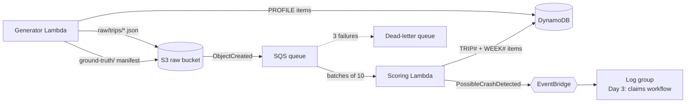

# insurance-telematics-genai

A deploy-and-destroy demo showing how an auto insurer can turn telematics data
into a differentiator with gen AI. Everything runs in your own AWS account,
is defined in **AWS CDK (Python)**, and uses **synthetic data only**.

| Day | Feature | Status |
|-----|---------|--------|
| 1 | Foundation: synthetic trip generator, rule-based scoring, weekly aggregates | ✅ this commit |
| 2 | Score explainer and coach (Bedrock) behind an API | planned |
| 3 | Possible crash → drafted claim (EventBridge + Step Functions + Bedrock) | planned (events already flowing) |
| 4 | Demo UI, agent copilot, demo script | planned |

## Architecture (Day 1)



**Generator** builds drivers in six metros with hidden personas (steady,
rusher, distracted, night owl, new driver) and week-over-week trends (some
improve, some decline). Each trip looks like a phone SDK upload: GPS/speed
samples every 10 s plus on-device events (hard brake, rapid acceleration,
harsh cornering, phone handling). It also plants a few **real crashes** and a
few **false alarms** (phone dropped in the footwell) as `possible_crash`
events with a 1 Hz window around the impact. The answer key (personas, which
crashes are real) goes to `ground-truth/` and is never scored.

**Scoring** is deliberately simple and explainable: start at 100 and deduct
capped points per factor. The per-factor `penalties` breakdown is what the
Day 2 explainer turns into plain-English coaching.

| Factor | Points | Cap |
|---|---|---|
| Hard braking | 2.0 per event per 100 mi | 25 |
| Rapid acceleration | 1.5 per event per 100 mi | 15 |
| Harsh cornering | 1.5 per event per 100 mi | 10 |
| Speeding (>10 mph over) | 1.0 per % of moving time | 20 |
| Phone handling | 4.0 per minute per driving hour | 25 |
| Late night (00:00–04:00 local) | 0.25 per % of driving time | 10 |

Rates use a 10-mile exposure floor so one event on a short trip doesn't wreck
the score. Weekly scores are computed from summed exposure and counts, not by
averaging trip scores. Possible crashes are not penalized; they go to claims.

### DynamoDB layout (single table)

| `driver_id` | `sk` | Holds |
|---|---|---|
| `DRV-0001` | `PROFILE` | name, policy, vehicle, metro, UTC offset |
| `DRV-0001` | `TRIP#<start_utc>#<trip_id>` | score, band, rates, penalties, totals, possible crashes, raw S3 key |
| `DRV-0001` | `WEEK#2026-W41` | summed counters (score derived on read) |

The trip write and the weekly `ADD` run in one transaction guarded by
`attribute_not_exists`, so SQS redeliveries never double count.

## Prerequisites

- AWS account and credentials (`aws sts get-caller-identity` works)
- Node.js 18+ and the CDK CLI: `npm install -g aws-cdk`
- Python 3.11+
- CDK bootstrapped once per account/region: `cdk bootstrap`

## Deploy, run, destroy

```bash
python3 -m venv .venv && source .venv/bin/activate
pip install -r requirements-dev.txt

make test        # unit + CDK template tests
cdk deploy       # ~3 minutes

make generate    # 20 drivers x 28 days (~1,000 trips), waits for scoring
make scores      # weekly score per driver
python scripts/demo.py trips DRV-0020   # one driver's trips + penalty breakdown
python scripts/demo.py crashes          # possible crashes (real and false alarms)

cdk destroy      # removes everything, including bucket contents and logs
```

`make generate` resets previous data by default. Options:
`python scripts/demo.py generate --drivers 50 --days 42 --seed 7 --crashes 5`.

No AWS handy? `make local` runs the same generator and scoring offline, writes
JSON to `./local_data`, and prints weekly scores next to the hidden personas.

## Cost

Pay-per-use only: Lambda, S3, SQS, DynamoDB on-demand, EventBridge. A full
generate run costs well under $0.10. Nothing runs between invocations, and
`cdk destroy` leaves nothing behind (the CDK bootstrap stack is shared and
stays).

## Repo layout

```
app.py                       CDK app
telematics/telematics_stack.py
lambdas/generator/           synth.py (pure generator) + handler.py
lambdas/scoring/             score.py (pure scoring) + handler.py
scripts/demo.py              generate / scores / trips / crashes / local
tests/                       pytest: scoring, generator, handlers (fakes), CDK template
```

All data is synthetic. Names, policies, and trips are generated and do not
describe real people.
